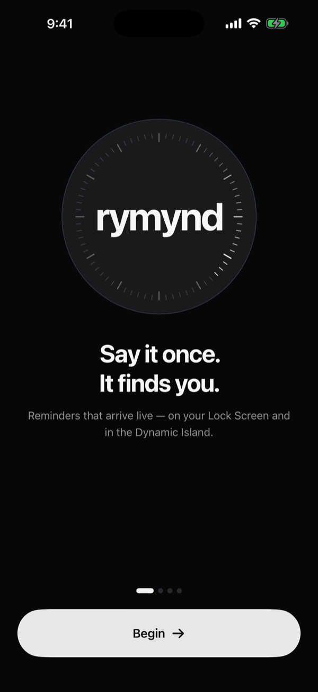
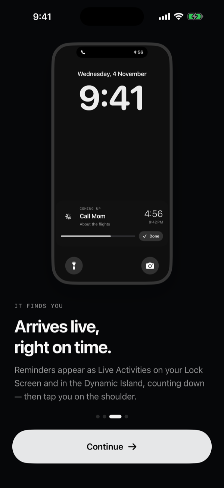
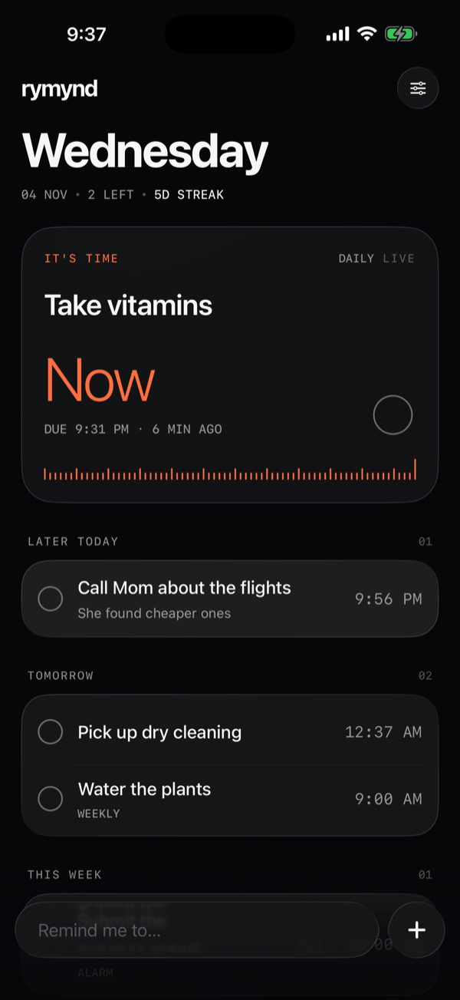
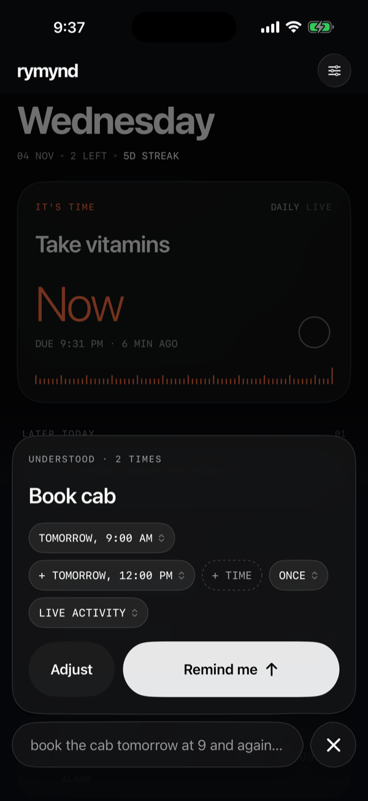
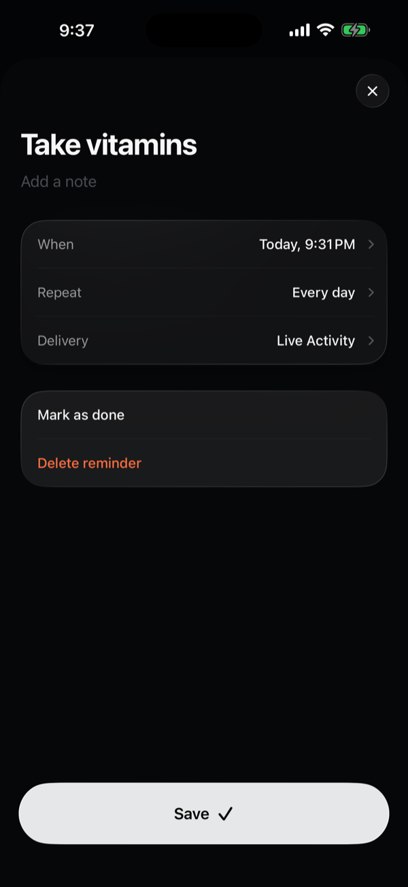

# Rymynd

**Say it once. It finds you.**

A sleek, dark Liquid Glass reminder app for iOS 26. Type a reminder the way you'd say it — *"book the cab tomorrow at 9 and again at 12"* — and Apple's on-device Foundation Model turns it into reminders that arrive as Live Activities, notifications or alarms.

<p align="center">
  
  
  
  
  
</p>

## Features

- **Plain-language input.** Type anything; the on-device model (FoundationModels) understands the title, time, repetition and urgency. Nothing leaves the phone. A deterministic parser backs it up and takes over on devices without Apple Intelligence.
- **Multiple times in one sentence.** "tomorrow at 9 and again at 12", "tomorrow afternoon and the day after", "8am and 8pm" — each becomes its own reminder.
- **Arrives live.** Reminders start as scheduled Live Activities on the Lock Screen and in the Dynamic Island, count down, and turn into "It's time" when due. Done and Snooze work right from the activity.
- **Three ways to be reminded.** Live Activity, a time-sensitive notification, or a full AlarmKit alarm for things you can't miss.
- **A wizard too.** Prefer tapping? A short step-by-step flow covers what, when, repeat and delivery.
- **Haptics with intent.** Custom Core Haptics patterns for completing, creating, snoozing and the model thinking, plus a tick through the last seconds of a countdown.
- **Designed to be quiet.** Near-black canvas, real Liquid Glass, white type and one signal colour reserved for "it's time". Motion carries the feedback: the title flies into its row when you create a reminder, a ripple runs through the card when you complete one.

## Tech

SwiftUI · Liquid Glass · FoundationModels · ActivityKit · AlarmKit · App Intents · UserNotifications · Core Haptics · Metal shaders · WidgetKit

## Requirements

- Xcode 26 and iOS 26
- An Apple Intelligence–capable iPhone for on-device parsing (other devices use the built-in parser)

## Getting started

The Xcode project is generated with [XcodeGen](https://github.com/yonaskolb/XcodeGen).

```sh
brew install xcodegen
xcodegen generate
open Rymynd.xcodeproj
```

Set your own development team and bundle identifiers in `project.yml` (and the App Group `group.com.rymynd.app` in the entitlements) before running on a device.

## Project layout

```
Rymynd/           App: features, design system, intelligence, delivery services
RymyndWidgets/    Live Activity and alarm UI (widget extension)
Shared/           Models, intents and activity views shared by the app and the extension
project.yml       XcodeGen spec
```
